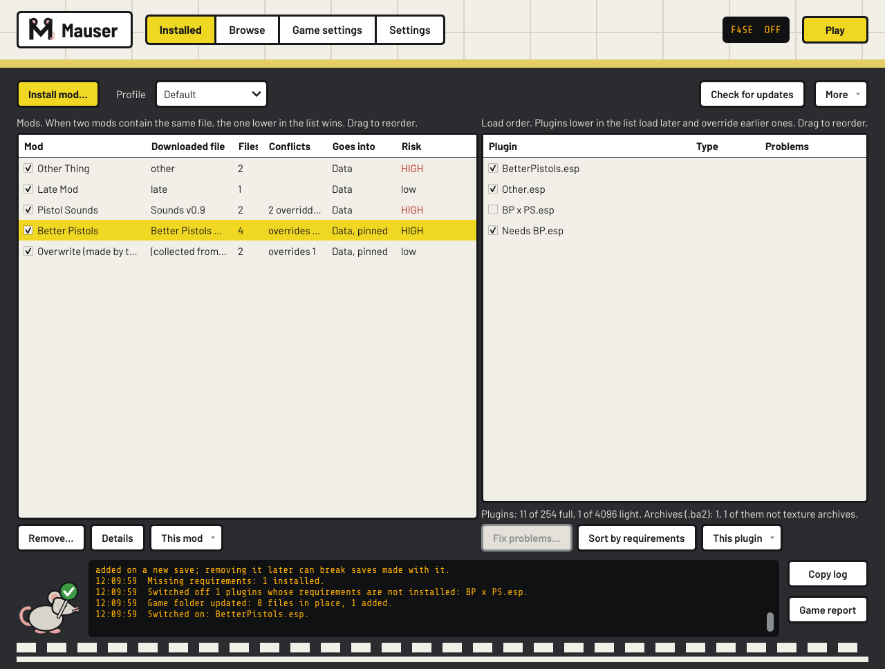
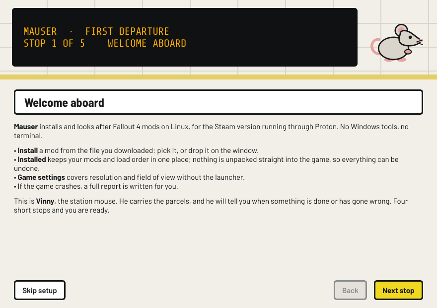

<p align="center">
  
</p>

<h1 align="center">Mauser</h1>

<p align="center">A Fallout 4 mod manager that runs on Linux, for people who are tired of pretending to run Windows.</p>



I mod Fallout 4 on Bazzite. The usual advice is to run a Windows mod manager
through Wine or fight with protontricks, and the native option I tried would
not work with my install. So I made my own. Mauser talks to the Steam copy of
the game inside its Proton prefix directly, and it is one file you download
and run.

It is version 1.2.0 and it has been used on exactly one machine: mine (Bazzite,
KDE, Wayland). It may well work on yours. If it does not, please open an issue
and tell me what happened.

## What you get

**Installing.** Drop a `.zip`, `.7z` or `.rar` on the window, or pick a
folder. Mods that come with an installer (FOMOD) get their options screen.

**A game folder you can get back.** Mods sit in their own library and are
linked into the game, so nothing is unpacked on top of your install. Mauser
keeps a record of every file it places, backs up anything it replaces, and one
button takes it all out again.

**Order, and what it means.** Drag mods and plugins into order. A conflicts
window shows which mod wins each file. Plugins that need something you do not
have are marked, with a way to fix them. A counter keeps an eye on the
plugin and archive limits.

**Finding things in a long list.** Give mods your own tags, filter by name or
tag, and sort by name, install date, size, file count or save risk. Sorting
only changes the view; the real order stays as you set it. The window works
down to 900 by 600.

**Profiles and lists.** Keep separate setups that share one mod library, each
with its own load order and game settings files. Save a setup to a small file
and rebuild it on another machine.

**Save safety.** Each mod gets a risk tag: high if it becomes part of your
save, low if you can add or remove it freely. You can point Mauser at a save
and it will tell you which plugins that save expects and which are missing.

**The bits the launcher used to do.** Resolution, window mode, vsync and
field of view, without opening the launcher. One switch makes Steam's Play
button start the game through F4SE.

**When it goes wrong.** If the game crashes, Mauser notices and writes a
report: likely causes first, then your mods, load order and the logs.

**Extras.** Run FO4Edit or BodySlide inside the game's Proton setup and have
their output collected into its own mod. Discord Rich Presence if you want it.
Four themes. A mouse called Vinny who carries the parcels.



## Nexus Mods: switched off for now

Mauser was built to browse Nexus Mods, install with one click, follow
requirement links and check for updates. From version 1.0.1 all of that is
**switched off**, and there is no setting to turn it back on.

Those features need permission from Nexus Mods to use their API in a public
app. I have asked, and there is a queue. Until I hear back, Mauser does not
talk to Nexus at all. The code is still here, behind one switch
(`NEXUS_AVAILABLE` in `common.py`), and it comes back in a release if
approval does.

Nothing else depends on it. Download a mod in your web browser, then install
it from the file. If you had entered an API key in 1.0, it is left in your
settings untouched and unused.

## Getting it

1. Download `Mauser` from the [latest release](https://github.com/TheQuartzite/Mauser/releases/latest).
2. Make it executable. In most file managers that is right-click, Properties,
   Permissions. In a terminal: `chmod +x Mauser`
3. Run it.

The first start takes a few seconds while it unpacks itself to
`~/.local/share/mauser-app` (about 180 MB). After that it opens quickly and
shows up in your application menu.

Before the first run, start Fallout 4 from Steam once and get as far as the
main menu, so the game has made its settings folder.

You need 64-bit Linux with glibc 2.39 or newer.

## Where it keeps things

| What | Where |
|---|---|
| Mod library, settings, crash reports | `~/.local/share/mauser` |
| The unpacked app | `~/.local/share/mauser-app` |
| Menu entry | `~/.local/share/applications/mauser.desktop` |

To remove Mauser completely, use **Settings > Remove all mod files from the
game**, then delete those three things.

## Running from source

```
git clone https://github.com/TheQuartzite/Mauser.git
cd Mauser
bash install.sh
```

That makes a `.venv` with PySide6 in it and adds a menu entry. If you would
rather do it by hand:

```
python -m venv .venv
.venv/bin/pip install -r requirements.txt
.venv/bin/python modmanager.py
```

`modmanager.py --diagnose` prints what Mauser can see of your game, which is
the first thing to paste into a bug report.

There are two test files that need neither the game nor a network:

```
python test_modmanager.py
python test_online.py
```

To build the single downloadable file, read the top of `packaging/build.py`.

## Licence

Mauser's own code is under the [MIT License](LICENSE), copyright Amy Amethyst.
The app also contains Qt, Python, 7-Zip and three fonts, each under its own
licence. Those are listed in [THIRD-PARTY-NOTICES.md](THIRD-PARTY-NOTICES.md)
and under **Settings > About** in the app.

Mauser is not made by, endorsed by or affiliated with Bethesda, ZeniMax,
Valve, Nexus Mods or Discord.

## AI-assisted disclosure

Most of Mauser's code was written with the help of an AI coding assistant,
working to my design and direction. I decided what the app does and how it
looks, and I run each build on my own setup before it goes up. Parts of it
have only ever been tested against stand-ins (a made-up save file, a pretend
Proton), so treat it as young software and keep backups of saves you care
about.
